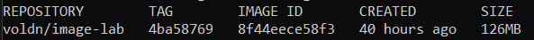
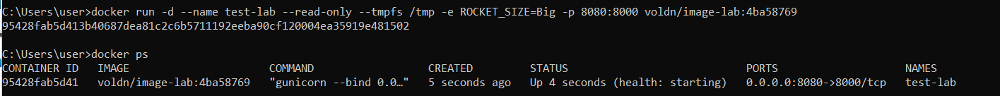
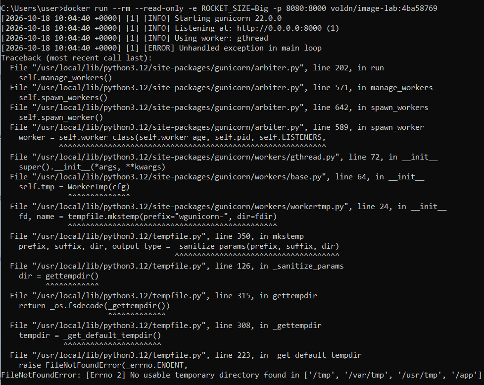
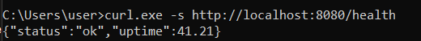
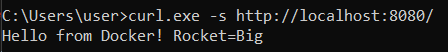
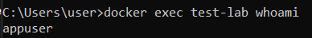
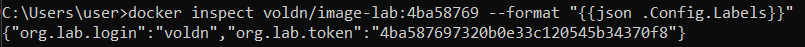
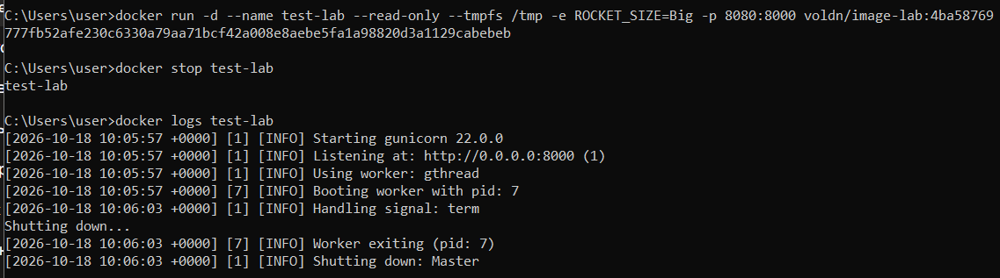
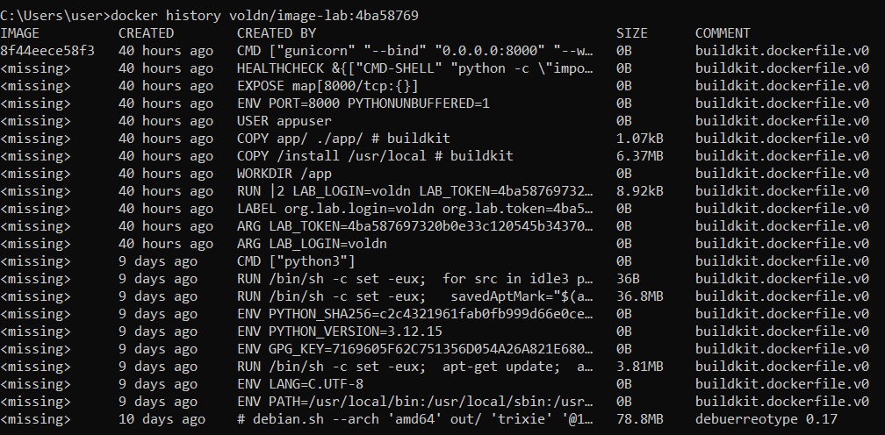

# Отчёт по лабораторной: Продакшн-образы Docker

**Студент:** voldn  
**Образ:** `voldn/image-lab:4ba58769`  
**Ссылка на Docker Hub:** https://hub.docker.com/r/voldn/image-lab/tags  
**Размер образа:** 126 MB

---

## 1. Сборка образа

Образ собран с помощью multi-stage Dockerfile.

Основные особенности:
- Stage 1 (builder) — установка зависимостей
- Stage 2 (runtime) — копирование только необходимых файлов
- Запуск под непривилегированным пользователем `appuser`
- Использование `gunicorn` вместо встроенного сервера Flask
- Наличие `HEALTHCHECK`
- Поддержка запуска с флагом `--read-only`
- Конфигурация через переменные окружения (`ROCKET_SIZE`)

---

## 2. Размер образа

```bash
docker images voldn/image-lab:4ba58769
```



Размер: 126 MB (требование < 150 MB выполнено).

---

## 3. Запуск контейнера (read-only)

```bash
docker run -d --name test-lab --read-only --tmpfs /tmp \
  -e ROCKET_SIZE=Big \
  -p 8080:8000 \
  voldn/image-lab:4ba58769
```



Контейнер успешно работает в режиме `--read-only`.

### Почему нужен `--tmpfs /tmp`

При запуске с флагом `--read-only` вся файловая система контейнера доступна только на чтение. Gunicorn при старте пытается создать временный файл в `/tmp`. Без writable-директории контейнер падает с ошибкой:

```
FileNotFoundError: No usable temporary directory found in ['/tmp', '/var/tmp', '/usr/tmp', '/app']
```



Параметр `--tmpfs /tmp` монтирует временную файловую систему в оперативной памяти, что позволяет gunicorn работать корректно.

---

## 4. Проверка эндпоинтов

### /health

```bash
curl.exe -s http://localhost:8080/health
```



### / (с ROCKET_SIZE)

```bash
curl.exe -s http://localhost:8080/
```



Переменная окружения `ROCKET_SIZE` корректно влияет на ответ без пересборки образа.

---

## 5. Проверка non-root пользователя

```bash
docker exec test-lab whoami
```



Приложение работает от пользователя `appuser`.

---

## 6. Проверка LABEL

```bash
docker inspect voldn/image-lab:4ba58769 --format "{{json .Config.Labels}}"
```



В образе присутствуют обязательные метки:
- `org.lab.login=voldn`
- `org.lab.token=4ba587697320b0e33c120545b34370f8`

---

## 7. Корректное завершение по SIGTERM

```bash
docker stop test-lab
docker logs test-lab
```



В логах видно корректную обработку сигнала:

```
Handling signal: term
Shutting down...
Worker exiting
Shutting down: Master
```

---

## 8. docker history

```bash
docker history voldn/image-lab:4ba58769
```



---

## 9. Почему этот образ лучше наивной сборки

1. Использована multi-stage сборка: зависимости устанавливаются в отдельном builder-слое, а в финальный образ копируется только необходимое. Это существенно уменьшает размер.
2. В качестве базового образа выбран `python:3.12-slim` вместо полного `python`, что сразу экономит десятки мегабайт.
3. Приложение запускается под непривилегированным пользователем (`USER appuser`), а не от root — повышается безопасность.
4. Добавлен HEALTHCHECK, который проверяет доступность эндпоинта `/health`.
5. Используется gunicorn вместо встроенного сервера Flask. Это даёт корректную обработку сигналов (в том числе SIGTERM) и лучшую производительность.
6. Образ корректно работает с флагом `--read-only` (при монтировании tmpfs на `/tmp`).
7. Параметр `ROCKET_SIZE` передаётся через переменную окружения и не требует пересборки образа.
8. В образ добавлены обязательные LABEL с логином и токеном лабораторной.

В результате получился компактный, более безопасный и production-ориентированный образ по сравнению с простой одностадийной сборкой вида `FROM python + COPY . + pip install + python app.py`.
